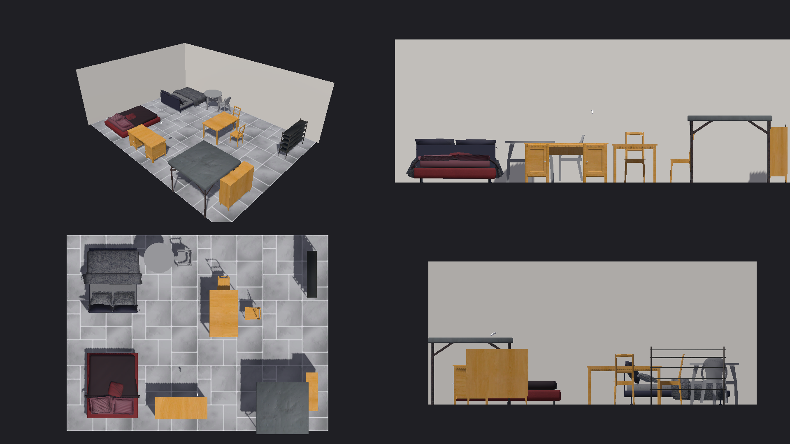
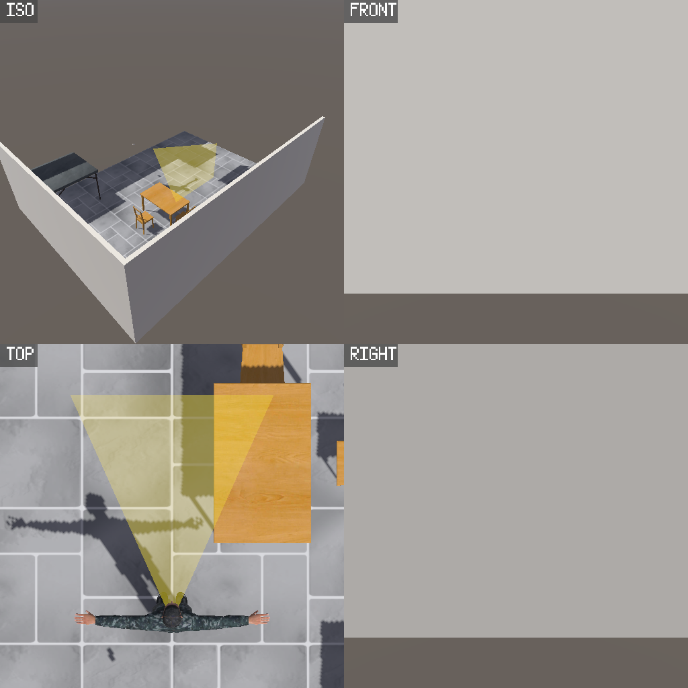
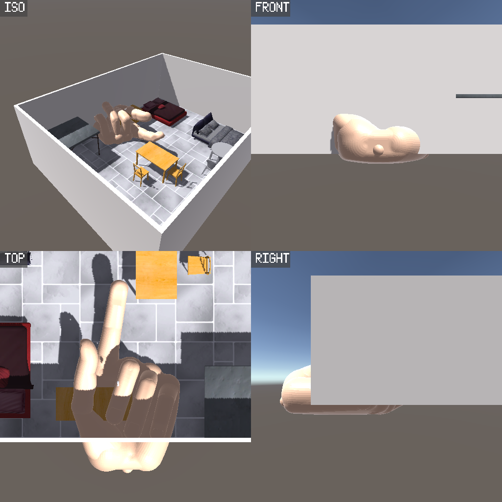

# DollHouseVR_Remake

Modern rebuild of a 2016 asymmetric-VR layout-planning prototype ("layout V3.1"),
based on the Dollhouse VR concept: **one user inhabits the room in VR at human
scale, the other looks down into it on a flat touchscreen and rearranges it** —
a designer/client collaboration tool where both see each other's presence.



## The two users

| | User A — VR player | User B — bird's-eye designer |
|---|---|---|
| Device | Quest 2 / 3 / Pro (standalone APK) | Windows touchscreen (or editor Play mode) |
| View | Inside the room, human scale | Orthographic top-down |
| Presence | Full humanoid avatar with gaze cone | Giant pointing hand + webcam face on the ceiling |
| Interactions | Walk (thumbstick), look, point | Drag + rotate furniture (two-finger twist / scroll wheel), point (giant finger), sketch annotations, webcam |

### The avatar and the vision cone

The VR player is embodied as a humanoid ("Bob", a reused 2016 rig). The body
walks and turns with real locomotion animations, the head mirrors the headset
(look up in VR → the avatar looks up at the designer), and two-bone arm IK makes
the avatar physically point where the controllers point. The yellow **vision
cone** shows the designer exactly where the VR player is looking — straight out
of the Dollhouse VR paper.



### The giant hand

When the designer touches the room, a **giant realistic hand** (an anatomical
model posed pointing with the index finger, also reused from 2016) descends
into the VR player's world, fingertip exactly at the touched spot.



### The ceiling webcam

The designer's webcam is JPEG-compressed and streamed through the Normcore
datastore onto the room's ceiling — the VR player who looks up sees the
designer's real face looking down at them.

### Sketching

The designer can toggle **Sketch** mode and draw strokes directly onto the
floor and furniture; strokes are networked and appear live in VR. **Clear**
wipes them for everyone.

## Stack

| 2016 original | This remake |
|---|---|
| Unity 5.6.1 | Unity 6000.3.18f1 (URP 17.3) |
| Oculus Rift + Xbox gamepad (OVR SDK) | OpenXR + XR Interaction Toolkit 3 (Touch / Touch Pro / Touch Plus profiles) |
| Photon PUN classic | Normcore 3 |
| Webcam physically on the VR PC | Webcam frames streamed over the network |
| Role switch with keyboard key | Automatic: Android build = VR, desktop = bird's-eye |

## Quick start

1. Create a (free) app at https://dashboard.normcore.io and paste its **App Key**
   into `Assets/DollHouse/Settings/NormcoreAppSettings.asset`
   (tracked copy holds a placeholder on purpose).
2. Open `Assets/DollHouse/Scenes/DollHouse.unity`.
3. **Editor Play mode** = the bird's-eye designer (no headset needed).
4. **Quest**: install `Builds/DollHouseVR.apk` (committed, Quest 2/3/Pro), or
   rebuild headlessly:

   ```bash
   Unity.exe -batchmode -quit -projectPath . -buildTarget Android -executeMethod DollHouse.EditorSetup.DollHouseSetup.BuildQuest
   ```
5. **Touchscreen PC**: unzip `Builds/DollHouseVR_Desktop_Win64.zip` and run
   `DollHouseVR.exe` (no VR initialized on desktop), or rebuild with
   `-buildTarget Win64 -executeMethod DollHouse.EditorSetup.DollHouseSetup.BuildDesktop`.
   Note: the prebuilt zip ships with the app key that was current at build
   time — rebuild after setting your own key.

Both clients auto-join Normcore room `DollHouse`.

## Where things live

- `Assets/DollHouse/Scripts` — all gameplay/network code (RoleManager,
  BirdsEyeController, SketchController, AvatarBodyDriver, WebcamCeilingStream,
  GiantFinger, AvatarVisuals).
- `Assets/Resources` — Normcore-instantiated prefabs (VRAvatar, GiantFinger,
  SketchStroke).
- `Assets/Legacy` — reused 2016 assets: furniture packs, textures, the Bob rig,
  the hand models, and the Standard Assets humanoid locomotion clips
  (materials auto-converted to URP).
- `Assets/DollHouse/Editor/DollHouseSetup.cs` — headless bootstrap that
  generated the scene, prefabs and all project/XR settings, plus the
  `BuildQuest` batch build entry point.
- `Builds/DollHouseVR.apk` — ready-to-sideload Quest build.

## Notes

- The screenshots above are editor scene-view captures taken during development
  (the 2×2 grids show isometric / front / top / right angles).
- The giant hand mesh is ~245k vertices (dense CAD model); decimate it if the
  Quest frame rate ever suffers.
